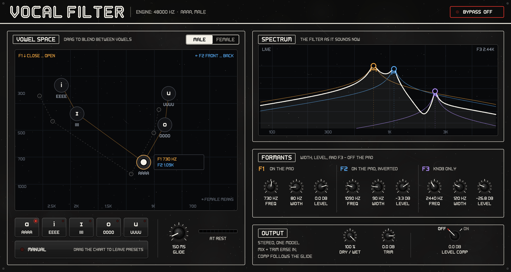

# VocalFilter

A three-formant vocal-tract model as a **VST3 and Audio Unit** effect for
macOS. Stereo in, stereo out. Feed it anything with harmonics and it puts a
vowel on it.



*(A layout render from `tools/render-panel.py`, not a screenshot — it is
generated from the editor's own layout tables (`source/VocalFilterLayout.h`)
and the DSP's own response functions, so it cannot drift from the code.)*

## What it does

On each channel, three bandpass resonators in **parallel**, summed, mixed
against the dry signal and trimmed:

```
in --+--> BP(F1) * A1 --+
     +--> BP(F2) * -A2 -+--> wet --+--> mix --> comp --> trim --> out
     +--> BP(F3) * A3 --+          |
     +--------- dry ---------------+
```

`comp` is **Level Comp**, an optional make-up gain (off by default) — see
Controls.

Parallel rather than cascaded because a parallel bank lets each formant carry
its own amplitude, which is the point of dialling a vowel by hand. F2 is
summed **inverted**: three bandpasses added in phase cancel between the peaks
and dig a null a real tract does not have.

[`docs/signal-path.png`](docs/signal-path.png) draws the whole thing —
including how the voice switch, the vowel selector and the glide reach the
filters, where the Level Comp gain is worked out and applied, and how the
displays and its reading get the values they show.

The filters are RBJ constant-0 dB-peak bandpasses, so a formant's Level is its
level and the Width control is not secretly a second gain.

## The five vowels, in two voices

One button each, a **Vowel** parameter the host can automate, and a **Voice**
switch between an adult male and an adult female tract.

| | Sound | F1 | F2 | F3 | B1 | B2 | B3 | A1 | A2 | A3 |
|---|---|---|---|---|---|---|---|---|---|---|
| Aaaa | /ɑ/ *father* | 730 | 1090 | 2440 | 80 | 90 | 120 | 0 | −3.3 | −26.8 |
| Eeee | /i/ *beet* | 270 | 2290 | 3010 | 50 | 100 | 140 | 0 | −8.0 | −2.3 |
| Iiii | /ɪ/ *bit* | 390 | 1990 | 2550 | 60 | 100 | 130 | 0 | −8.2 | −7.6 |
| Oooo | /o/ *boat* | 450 | 900 | 2400 | 60 | 90 | 120 | 0 | −7.4 | −30.0 |
| Uuuu | /u/ *boot* | 300 | 870 | 2240 | 50 | 90 | 120 | 0 | −10.2 | −30.0 |

Frequencies in Hz above are the classic adult-male means from **Peterson &
Barney (1952)**, so all five sit in one consistent voice. The exception is
Oooo: the letter O names a diphthong, /oʊ/, which they did not measure, so
that row carries the common /o/ set and is marked as such in the source.

The **female** table is their adult-female means — a shorter tract, so every
formant higher: Aaaa becomes 850/1220/2810 and Eeee 310/2790/3310. Oooo is
scaled from the male /o/ set by the mean male-to-female ratio of the three
back vowels P&B *did* measure.

Bandwidths sit mid-range of the measured adult spread, narrower at B1 for the
close vowels.

**Levels are derived, not chosen.** A vocal tract is an all-pole filter, so
formant amplitudes are a consequence of the frequencies rather than free
parameters — which is why a cascade synthesiser needs no amplitude controls
and a parallel one cannot do without them. Each pair is fitted against the
all-pole cascade those formants imply. `ENGINEERING-NOTES.md` §2 has the method,
the numbers and the two wrong answers that came first.

**Both voices share those levels**, deliberately: a shorter tract moves where
the resonances sit, not much how they are balanced. Refitting them for the
female set puts one formant outside its parameter's range and gives /i/ no F2
peak at all — §2d has the measurements.

## Controls

| Parameter | Range | Default |
|---|---|---|
| F1 / F2 / F3 **Freq** | 200–1200, 500–3000, 1500–4000 Hz | the Aaa patch |
| F1 / F2 / F3 **Width** | 20–400 Hz | 80 / 90 / 120 |
| F1 / F2 / F3 **Level** | −40 … +12 dB | 0 / −3.3 / −26.8 |
| **Dry / Wet** | 0–100 % | 100 |
| **Glide** | 0–2000 ms | 150 |
| **Output Trim** | −60 … +12 dB | 0 |
| **Vowel** | Manual, Aaaa, Eeee, Iiii, Oooo, Uuuu | Manual |
| **Voice** | Male, Female | Male |
| **Level Comp** | Off, On | Off |

**Glide** is how long a formant takes to reach a new value. It is a timed
linear ramp, one length for all nine parameters, so however far each has to
travel they all arrive on the same sample. 150 ms by default because that is
roughly what a diphthong glide takes in speech. Zero is floored at 20 ms — an
instant jump of F2 from 870 Hz to 2290 Hz is a click.

**Vowel** is a mode. While it is on a preset the DSP uses that vowel's values
and the nine formant parameters are ignored; touching a formant knob, dragging
on the vowel chart or pressing **Manual** captures the preset's values and
switches back to Manual, so nothing jumps.

**Voice** picks which of the two tables a preset comes from. It is read by the
processor the same way, so it works with the editor closed and under
automation, and a voice change glides exactly as a vowel change does — it just
moves F2 by at most 3.8 semitones against up to 16.8, so the same Glide time
sounds far less dramatic.

**Level Comp** adds a make-up gain so the output stays at about the input's
loudness. A formant bank throws most of the spectrum away, so fully wet it is
roughly 14–16 LU quieter than its input, by an amount that changes with every
vowel. The gain is worked out from the filter itself — vowel, voice, the
formant settings and Dry / Wet — rather than from the audio. So it follows a
glide, never pumps and adds no latency. Pink noise comes out within half an LU
of where it went in; other sources land near that. It is off by default, so
projects saved before it existed sound unchanged. On the panel it is the
**rotary selector** (OFF / ON) in the Output section. The reading under it
shows the make-up being applied right now, and it follows a glide.

### The panel

Four sections, in R2Synth's style (layout: `design/VocalFilter-Concept3b-VowelSpace.png`),
dressed as R2Synth's black panel (`design/VocalFilter-Polivoks-1-BlackPanel.png`):
matte black, white printing, knurled knobs, black keys with red lamps, and
every word in the 70s sci-fi lettering, with light wear.

* **Vowel space** — a vowel chart you can play. F2 runs across (falling to
  the right) and F1 down (falling downward), the way phoneticians plot
  vowels, over exactly the two parameters' ranges. The five vowels of the
  current voice are labelled circles; the other voice's are faint dots.
  **Click a vowel** to select it; **drag anywhere** to move F1 and F2
  together (Shift for fine). The white dot is where the DSP is right now, and
  during a glide its path is drawn from where it started to where it is
  going. Under the chart: the five vowel buttons, **Manual**, **Glide**, and
  how far through the current glide the sound is.
* **Spectrum** — each formant's response in its colour (F1 amber, F2 blue,
  F3 violet), the summed response in white, a handle on each peak and a
  bracket for its width. Fixed axes, 80 Hz – 8 kHz and +12 to −66 dB, so two
  vowels can be compared; the floor is that low because three resonators
  summed with alternating polarity notch far deeper than any one does.
* **Formants** — Freq, Width and Level knobs for each formant. While a preset
  is live they show the preset's values.
* **Output** — Dry / Wet, Trim and the **Level Comp** selector, with the
  make-up it is applying read out under it. **Bypass** is the pill in the header.

Knobs: drag vertically, Shift for fine, double-click for the default, the
wheel steps.

## Building

macOS, Xcode and CMake 3.25+.

```sh
git clone https://github.com/acobley/VocalFilter-VSTi.git
cd VocalFilter-VSTi
./setup-xcode.sh
```

The first configure clones the Steinberg VST3 SDK (~250 MB) into `external/`,
which takes a few minutes; later ones reuse it. To use a checkout you already
have:

```sh
VST3_SDK_ROOT=/path/to/vst3sdk ./setup-xcode.sh
```

`./setup-xcode.sh --help` lists the rest — `--no-open`, `--makefiles`,
`--no-au`, `--no-validator`, `--clean`.

Both bundles are ad-hoc signed automatically, which is enough for macOS to
load them, Apple Silicon included. Before shipping, run Steinberg's validator
and `auval -v aufx VcFl AECo`.

> **If you add a source file**, re-run `./setup-xcode.sh --no-open` before
> building. Sources are globbed with `CONFIGURE_DEPENDS`, and under the Xcode
> generator the first build after a file is added compiles the old file list
> anyway; a PRE_BUILD check catches it and names what changed.

## Tests

Three suites, none of which needs a host or a build system. `tools/run-tests.sh` runs them all, with `tests/LayoutTests.cpp` holding the panel's layout tables to fitting and not overlapping.

The DSP is deliberately free of SDK types, so its suite compiles and runs
standalone:

```sh
c++ -std=c++17 -O2 -Isource tests/DspTests.cpp source/VocalFilterDsp.cpp \
    -o /tmp/dsptests && /tmp/dsptests
```

The parameter table needs the SDK's headers but none of its code, so its suite
links against a single translation unit:

```sh
c++ -std=c++17 -O2 -Isource -Iexternal/vst3sdk \
    tests/ParamsTests.cpp source/VocalFilterParams.cpp \
    -o /tmp/paramstests && /tmp/paramstests
```

At 1.3.0.0 they make 87, 37 and 203 assertions. They measure rather
than assume: where the formant peaks actually land, that the running filter
matches the curve the display draws, that the −3 dB width is the width that
was asked for, that the response is unchanged from 44.1 k to 192 k, that every
glide setting lands on the right sample, and that the fastest legal glide is
far quieter at 6–12 kHz than an instant jump — asserted at 30 dB, measured at
36 — and that with Level Comp on, pink noise through every vowel comes out
within half an LU of its input loudness.

The parameter suite covers what the DSP one structurally cannot see: that
every id is classified exactly once, that a setting is not mistaken for one of
the published display values, and that the normalised → voice → table
conversion reaches both tables. It exists because a range check bounded by the
end of the table once made the Voice switch silently do nothing.

Several assertions include a negative control, because a guard that has never
failed is a guess.

## Repository layout

| | |
|---|---|
| `source/` | the plug-in — `VocalFilterDsp.*` is the audio line and includes no SDK header |
| `tests/` | `DspTests.cpp`, SDK-free; `ParamsTests.cpp` and `LayoutTests.cpp`, headers only |
| `tools/render-panel.py` | renders the panel to `docs/` from `tools/dump-layout.cpp`, which reads the layout tables |
| `design/` | the interface concepts the panel was chosen from |
| `tools/check-editor.py` | guards one editor invariant no runtime test can reach |
| `docs/` | those renders, and the signal-path diagram — `docs/README.md` says how each is regenerated |
| `resource/au-info.plist` | the Audio Unit's identity |
| **`ENGINEERING-NOTES.md`** | **the engineering record** — every decision, the measurement behind it, and the things that turned out wrong |
| `LICENSE` | CC BY-SA 4.0, and what it does not cover |

VocalFilter is **not a port of anything** — there is no DXi behind it. It was
scaffolded from the build system the SpaceDub, ForTran and SpyBand DXi→VST3
ports share, which is where `CMakeLists.txt` and `setup-xcode.sh` come from;
the porting guide and checklist that template also carries have been removed,
because nothing here was ported and they only described how to. The custom
VSTGUI controls are lifted from the SpyBand port, with the class names kept so
the two copies can still be diffed.

## Identity

Bundle ids `audio.vocalfilter.vst3` and `audio.vocalfilter.audiounit`; Audio
Unit type/subtype/manufacturer `aufx` / `VcFl` / `AECo`. Along with the class
UIDs in `source/VocalFilterIDs.h`, these are permanent once a build has
shipped — change one and every existing session loses the plug-in.

---

Copyright 2026 A. E. Cobley. Licensed under
[CC BY-SA 4.0](https://creativecommons.org/licenses/by-sa/4.0/) — see
[`LICENSE`](LICENSE). Credit it, and share anything you build on it under the
same terms.

The Steinberg VST3 SDK and VSTGUI are not covered by that: they are fetched
into `external/` at configure time and carry their own licence terms.

VST is a trademark of Steinberg Media Technologies GmbH.
